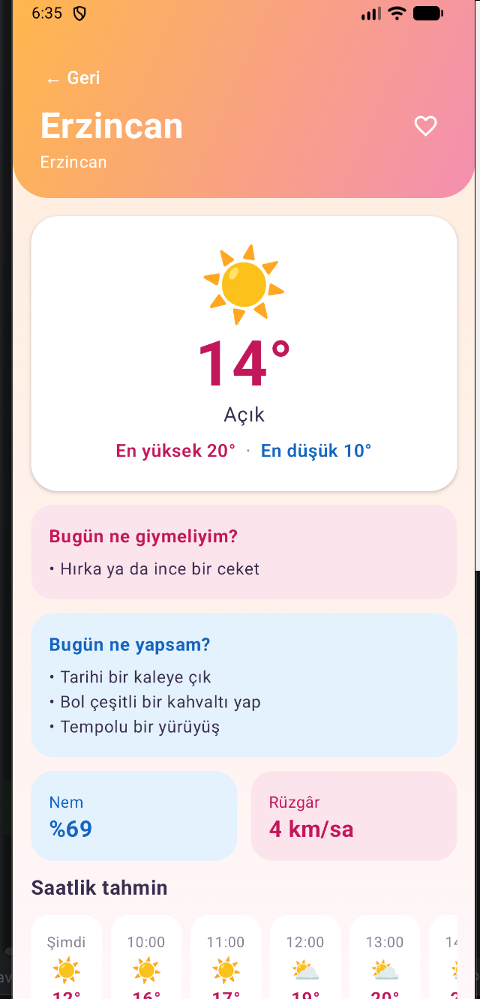
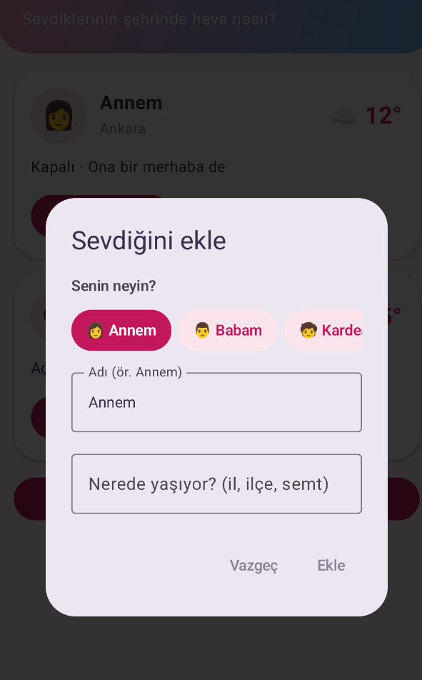
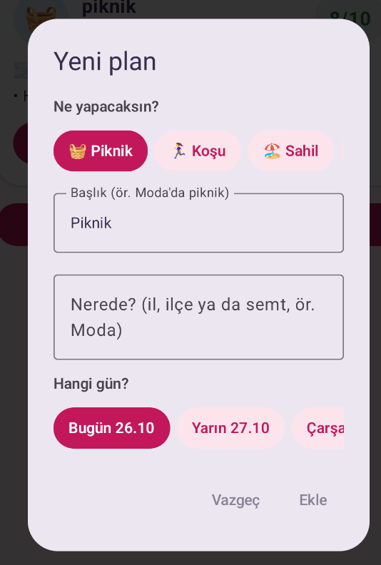

<p align="center">
  
</p>

# CloudHeart

Hava durumu uygulamaları genelde sadece "bugün kaç derece?" sorusuna cevap verir. Ben biraz
daha ileri gitmek istedim: Annemin şehrinde hava nasıl? Cumartesi pikniği yağmura denk gelir mi?
Bugün ne giysem, nereye gitsem?

CloudHeart bu soruların cevabını veren, pembe-mavi, küçük bir Android uygulaması. Bilişim
Kampı'ndaki Android eğitimi için Kotlin ve Jetpack Compose ile geliştirdim

<p align="center">
  
  
  
  
</p>

## Uygulamada neler var?

### Şehirler ve favoriler


Ana ekranda Türkiye'nin 81 ili plaka numaralarıyla listeleniyor. Arama kutusuna birkaç harf
yazınca il ve ilçe önerileri çıkıyor; mesela "mala" yazınca Malatya ve Malazgirt geliyor.

Beğendiğin yeri kalbe dokunarak favorilerine ekleyebilirsin. Sadece iller değil, Kadıköy
gibi ilçeler de favori olabiliyor.

Bir ile dokununca önce o ilin havası, sayfanın sonunda da bütün ilçelerinin o anki havası
görünüyor. Mesela İstanbul'un 39 ilçesinin havası tek seferde geliyor.

<br clear="right">

### Havaya göre renk değiştiren ekran

Şehrin detay sayfasının üst kısmı o anki havaya göre renk değiştiriyor. Güneşli bir günde
turuncu-pembe, kapalı havada mor-mavi, yağmurda mavi oluyor. Gece olunca da gece mavisine dönüyor.

<p align="center">
  
  
  
</p>
<p align="center"><sub>Aynı sabah üç şehir: Erzincan güneşli, İstanbul kapalı, Muğla'da sağanak var.</sub></p>

<p align="center">
  
</p>

Detay sayfasında saatlik ve 7 günlük tahmin, nem ve rüzgâr bilgisinin yanında iki öneri kartı var:

- **Bugün ne giymeliyim?** Sadece sıcaklığa değil, rüzgâra, neme ve akşam serinliğine de bakıyor.
  Muğla'da sağanak varken "yağmurluk giy" diyor, Trabzon'da "Karadeniz'de hava çabuk değişir,
  yağmurluğun çantanda dursun" diye hatırlatıyor.
- **Bugün ne yapsam?** Şehre göre öneri veriyor. Trabzon'da Boztepe'yi ve kuymağı, İstanbul'da
  Bebek'ten Arnavutköy'e sahil yürüyüşünü ve Eminönü'nde balık ekmeği öneriyor. Yağmur yağıyorsa müze, kafe gibi kapalı
  yerler geliyor. Öneriler her gün değişiyor.

### Sevdiklerim


Bu bölüm uygulamanın en sevdiğim kısmı. Annemi, babamı, kardeşimi ya da bir arkadaşımı
yaşadığı şehirle birlikte ekliyorum; hepsinin şehrindeki havayı tek ekranda görüyorum.

Her kartta o şehrin sıcaklığı ve havası, altında da kısa bir not var: "Yağmur var, şemsiyesini
alsın" ya da "Hava güzel, dışarı çıksın" gibi.

**Mesaj gönder** butonuna basınca uygulama o kişiye uygun bir mesaj hazırlıyor ve WhatsApp
ya da istediğin bir uygulamayla gönderebiliyorsun. Anneme giden mesaj mesela şöyle:

> Annecim, nasılsın?<br>
> Ankara'da şu an 10°, hava kapalı ☁️<br>
> Serin, dışarı çıkarsan üstüne bir hırka al<br>
> Seni çok seviyorum 💕

Arkadaşa giden mesaj daha farklı, babaya ya da kardeşe giden de öyle.

<br clear="right">



**Sevdiğini eklemek** de kolay: önce kim olduğunu seçiyorsun (annem, babam, kardeşim,
arkadaşım...), sonra adını ve nerede yaşadığını yazıyorsun. Şehri yazarken il ve ilçe
önerileri çıkıyor, içlerinden birine dokunman yeterli. Seçtiğin yakınlığa göre mesajın
hitabı da değişiyor: anneye "annecim", babaya "babacım" diye yazıyor.

<br clear="right">

### Planlarım


Piknik, koşu, sahil, şehir gezisi ya da kahve buluşması gibi bir plan ekliyorsun; şehri ve
günü seçiyorsun. Uygulama o günün tahminine bakıp plana 10 üzerinden bir puan veriyor ve
nedenini de yazıyor: "Yağmur bekleniyor (%90)" gibi.

Haftanın başka bir günü daha uygunsa onu da söylüyor. Mesela yarınki piknik 0/10 alırken
"Bugün daha uygun: 9/10" diyor.

Puan etkinliğe göre değişiyor. Yağmurlu bir gün piknik için kötü ama kahve buluşması için
sorun değil. **Davet et** butonuyla planı, tarihi ve havayı içeren bir mesajı arkadaşlarına
gönderebiliyorsun.

<br clear="right">



**Yeni plan eklerken** önce ne yapacağını seçiyorsun: piknik, koşu, sahil, şehir gezisi ya
da kahve buluşması. Başlık kendiliğinden doluyor, istersen değiştirebilirsin. Sonra yeri
yazıyorsun; il, ilçe ya da semt olabilir. En son da günü seçiyorsun: bugün, yarın ya da
haftanın başka bir günü. Ekle'ye basınca plan, puanıyla birlikte listeye geliyor.

<br clear="right">

## Kullandığım teknolojiler

- Kotlin ve Jetpack Compose (Material 3)
- ViewModel, StateFlow ve Coroutines
- Retrofit ve Gson
- Navigation Compose
- SharedPreferences (favoriler, sevdiklerim ve planlar telefonda saklanıyor)
- JUnit ile 58 birim testi

Hava verileri [Open-Meteo](https://open-meteo.com)'dan, yer araması [OpenStreetMap](https://www.openstreetmap.org)'ten
geliyor. İkisi de ücretsiz ve API anahtarı istemiyor.

## Nasıl çalıştırılır?

1. Projeyi indir: `git clone https://github.com/nurefsann07/CloudHeart.git`
2. Android Studio ile aç ve Gradle'ın bitmesini bekle.
3. Run'a bas. Başka bir ayar gerekmiyor.

Testleri çalıştırmak için: `./gradlew testDebugUnitTest`

## Proje yapısı

Kampta öğrendiğimiz katmanlı yapıyı kullandım. Her katmanın tek bir işi var:

- **ui:** Ekranı çizer. İnternete gitmez, sadece kendisine verilen durumu gösterir.
- **ViewModel:** Ekranın durumunu tutar ve yönetir (yükleniyor, geldi, boş, hata).
- **data (Repository):** Veriyi internetten ya da telefondan getirir.
- **model:** Uygulamanın kuralları; puan hesabı, kıyafet ve aktivite önerileri, mesajlar.

```
UI (Compose)  →  ViewModel (StateFlow)  →  Repository  →  Retrofit → Open-Meteo / OpenStreetMap
                                                      →  SharedPreferences (telefon)
```

```
com.example.havadurumu
├── MainActivity.kt
├── model/          City, Forecast, Person, Plan, PlanAdvisor (puan), Advice (öneriler, mesajlar), LocalFlavor (şehre özel öneriler)
├── data/           WeatherRepository, PlaceRepository, DistrictRepository, AppContainer
│   ├── remote/     Retrofit servisleri ve JSON modelleri
│   └── local/      Favoriler, sevdiklerim ve planların kaydı
└── ui/             Ekranlar: city, forecast, people, plans + ortak parçalar ve tema
```

Her ekran iki parçadan oluşuyor: `Route` ViewModel'den durumu alıyor, `Screen` sadece çiziyor.
Böylece ekranları `@Preview` ile önizleyebiliyorum.

İnternet yoksa, sunucu cevap vermiyorsa ya da şehir bulunamazsa uygulama çökmüyor; ekranda
anlaşılır bir mesaj ve "Tekrar dene" butonu çıkıyor. Aynı şehrin havası 10 dakika içinde
tekrar istenirse internete gitmeden hafızadan geliyor.

### Plan puanı nasıl hesaplanıyor?

10 puandan başlıyor ve şunlara göre düşüyor:

1. **Yağış:** Yağmur ihtimali ne kadar yüksekse o kadar düşüyor. Piknik yağmurdan çok
   etkileniyor, kahve buluşması az.
2. **Sıcaklık:** Etkinliğin ideal sıcaklığından uzaklaştıkça düşüyor.
3. **Rüzgâr:** Sert rüzgârda düşüyor.
4. **Fırtına ve kar:** Açık hava etkinliklerinde ekstra düşüyor.

Başka bir gün en az 2 puan daha iyiyse o gün öneriliyor.

## Testler

Önemli kuralların hepsini birim testleriyle kontrol ettim. Bazıları:

- Plan puanı doğru hesaplanıyor mu, yağmurlu bir güne yüksek puan veriliyor mu?
- "Kadıköy" aranınca İstanbul'daki Kadıköy mü bulunuyor?
- Şehre özel öneriler doğru şehirde mi çıkıyor, her gün değişiyor mu?
- İnternet yokken ekranda doğru hata mesajı görünüyor mu?

---

Bilişim Kampı · Turkcell Geleceği Yazanlar · Mobil Uygulama Geliştirme (Android) · 2026
