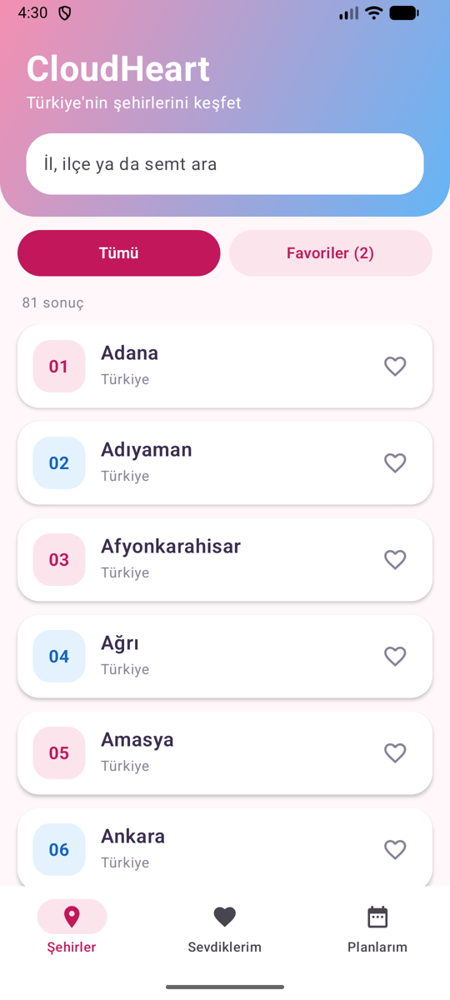
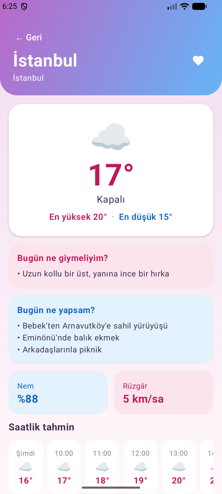
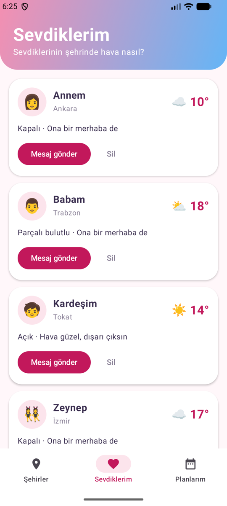
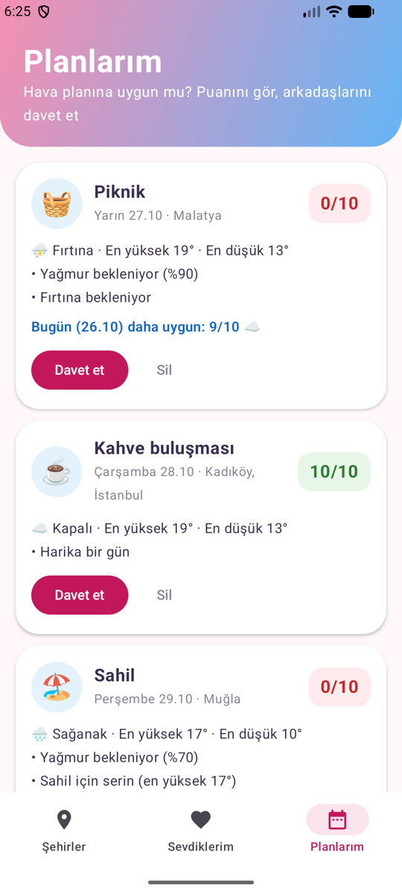
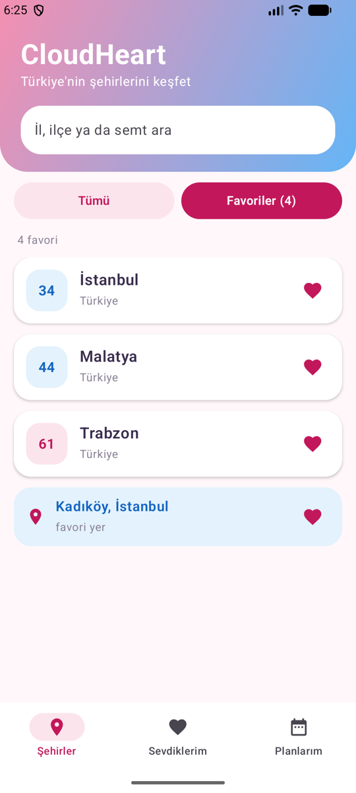
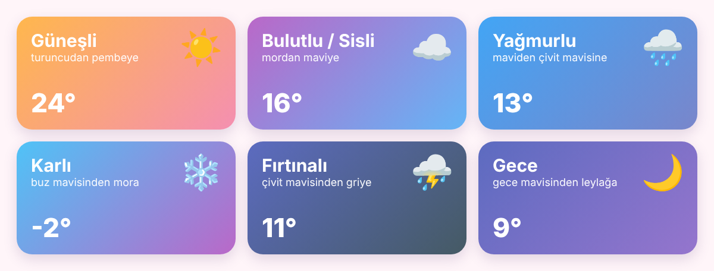
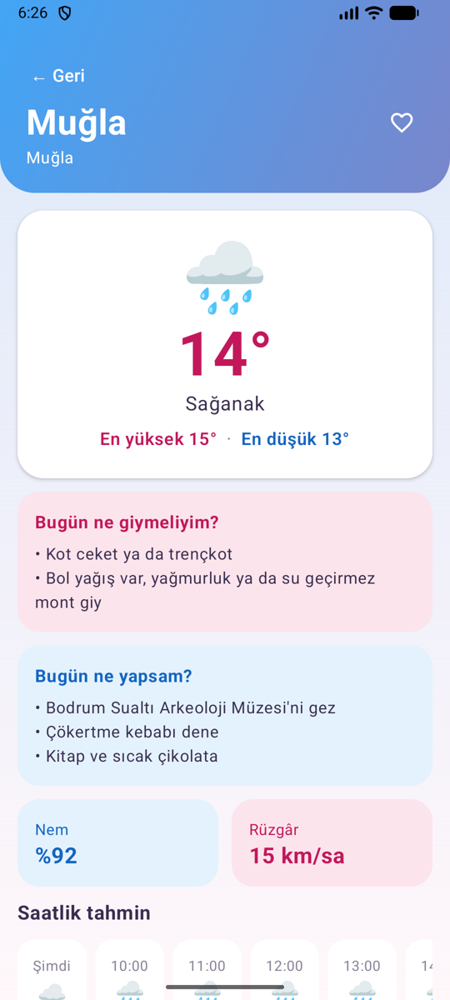
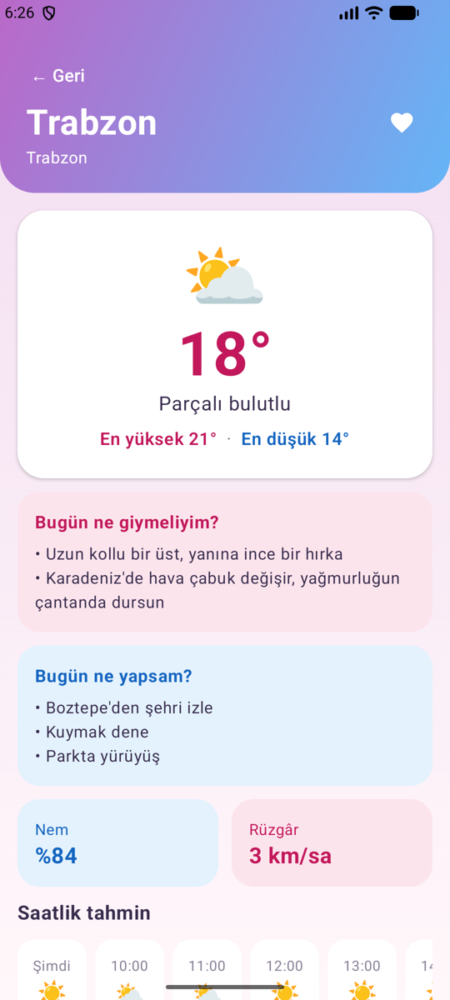

<p align="center">
  
</p>

<h1 align="center">CloudHeart</h1>

<p align="center">
  <b>Sevdiklerinin ve planlarının hava asistanı</b><br>
  
  
  
  
  
</p>

CloudHeart sadece "hava kaç derece?" sorusuna cevap vermez; havayı insanların gerçek hayattaki
kararlarına bağlar: **Annemin şehrinde hava nasıl? Cumartesi pikniği için hava uygun mu?
Kadıköy'de bugün ne giysem, ne yapsam?**

## Ekran görüntüleri

<p align="center">
  
  
  
  
</p>

## Özellikler

### 🏙️ Şehirler ve favoriler



- **81 il** tek listede; plaka numarasıyla birlikte.
- **Yazdıkça öneri:** "mala" yazınca Malatya ve Malazgirt çıkar. Türkçe karakter gerekmez:
  "kadikoy" → Kadıköy, "uskudar" → Üsküdar.
- Uygulamanın içinde **922 ilçelik** resmî liste var; ilçe önerileri anında ve internetsiz gelir.
  Semtler (Moda, Bebek...) OpenStreetMap'ten gelir, alakasız sonuçlar süzülür.
- **Favoriler:** Kalbe dokunarak il, ilçe ya da semt ekleyebilirsin. Favoriler sekmesinde
  İstanbul'un yanında "Kadıköy, İstanbul" gibi ilçeler de görünür.
- Bir ile dokununca önce ilin havası, altında **bütün ilçelerinin anlık havası** listelenir
  (İstanbul'un 39 ilçesi tek istekte gelir).

<br clear="right">

### 🎨 Havaya göre değişen tema

Detay ekranının başlığı, o şehrin **o anki havasına ve gece/gündüze göre** renk değiştirir:

<p align="center">
  
</p>

<p align="center">
  
  
  
</p>
<p align="center"><sub>Gerçek ekranlar: İstanbul kapalı · Muğla sağanak · Trabzon parçalı bulutlu</sub></p>

Detay ekranında ayrıca:
- **Bugün ne giymeliyim?** Rüzgârın hissettirdiği sıcaklığa, neme, akşam serinliğine ve bölgeye bakar.
  Muğla'da sağanakta "Bol yağış var, yağmurluk giy", Trabzon'da "Karadeniz'de hava çabuk değişir,
  yağmurluğun çantanda dursun" der.
- **Bugün ne yapsam?** Şehre özel yerler ve lezzetler önerir: Trabzon'da "Boztepe'den şehri izle,
  kuymak dene", yağmurlu Muğla'da "Bodrum Sualtı Arkeoloji Müzesi'ni gez". Öneriler her gün değişir.
- Anlık, saatlik ve 7 günlük tahmin; nem ve rüzgâr.

### 💌 Sevdiklerim


Annenin, babanın, kardeşinin, arkadaşının **yaşadığı şehirdeki havayı tek ekranda** gör.

- **Sevdiğini ekle:** adını, yakınlığını (annem, babam, kardeşim, arkadaşım...) ve şehrini seç.
  Şehir yazarken il ve ilçe önerileri çıkar.
- Her kartta o şehrin **anlık sıcaklığı ve havası**, altında kısa bir not:
  "Hava güzel, dışarı çıksın", "Yağmur var, şemsiyesini alsın".
- **Mesaj gönder:** Yakınlığa göre samimi bir mesaj hazırlanır, WhatsApp ya da istediğin
  uygulamayla tek dokunuşla gönderilir:

  > Annecim, nasılsın?<br>
  > Ankara'da şu an 10°, hava kapalı ☁️<br>
  > Serin, dışarı çıkarsan üstüne bir hırka al<br>
  > Seni çok seviyorum 💕

- Türkçe ekler doğru çekilir: Ankara'**da**, İzmir'**de**, Sinop'**ta**.

<br clear="right">

### 📅 Planlarım


Bir plan oluştur, **hava o plana uygun mu** CloudHeart söylesin.

- **Plan ekle:** etkinliği seç (piknik, koşu, sahil, şehir gezisi, kahve buluşması),
  başlık kendiliğinden dolar; şehri ve günü seç.
- O günün tahminine göre **10 üzerinden uygunluk puanı** ve **nedenleri**:
  "Yağmur bekleniyor (%90)", "Sahil için serin".
- Haftanın **daha uygun bir günü** varsa önerir: "Bugün (26.10) daha uygun: 9/10".
- **Davet et:** Plan, tarih ve havayı içeren bir davet mesajı arkadaşlarına gönderilir.
- Puanlama etkinliğe göre değişir: aynı yağmurlu gün piknik için 0/10, kahve buluşması için çok daha yüksek puan alır.

<br clear="right">

## Teknolojiler

Kotlin · Jetpack Compose (Material 3) · ViewModel + StateFlow · Coroutines · Retrofit + Gson ·
Navigation Compose · SharedPreferences · JUnit

## Çalıştırma

1. Projeyi klonla: `git clone <bu deponun adresi>`
2. Android Studio ile aç, Gradle eşitlemesini bekle.
3. ▶️ **Run**. API anahtarı gerekmez.
4. Testler: `./gradlew testDebugUnitTest`

---

## Mimari: üç katman

> UI görünümü çizer, ViewModel state'i yönetir, Repository veriye erişir.

```
UI (Composable)  →  ViewModel (StateFlow)  →  Repository  →  Retrofit → Open-Meteo
                                                         →  PreferencesStore (cihaz)
```

```
com.example.havadurumu
├── MainActivity.kt              Uygulamanın kapısı
├── model/                       Veri neye benzer? İş kuralları neler?
│   ├── City.kt                  81 il
│   ├── Forecast.kt              Place, CurrentWeather, HourlyForecast, DailyForecast
│   ├── WeatherCondition.kt      WMO kodu → emoji + Türkçe etiket
│   ├── Person.kt / Plan.kt      Sevdiklerim ve planlarım + ActivityType
│   ├── PlanAdvisor.kt           🚦 Uygunluk puanı ve "daha iyi gün" hesabı
│   ├── LocalFlavor.kt           🗺️ Şehre özel yerler/lezzetler, 7 bölge
│   ├── Advice.kt                👗 Kıyafet, 🎯 aktivite, 💌 mesaj, 📨 davet
│   └── Dates.kt                 Gün adları, "Bugün / Yarın"
├── data/                        Veri nereden gelir?
│   ├── WeatherRepository.kt     Tek kapı + 10 dakikalık önbellek
│   ├── PlaceRepository.kt       Yer bulma ve öneriler (OpenStreetMap + Open-Meteo)
│   ├── DistrictRepository.kt    İl → ilçeler (assets/districts.json) + hepsinin havası tek istekte
│   ├── AppContainer.kt          Elle bağımlılık enjeksiyonu
│   ├── remote/                  Retrofit API'leri, JSON kalıpları, sütun→satır çevrimi
│   └── local/                   Favoriler, Sevdiklerim, Planlarım (cihazda kalıcı)
└── ui/                          Ne çizilir, ne zaman değişir?
    ├── LoadState.kt             Loading / Success / Empty / Error + Türkçe hata mesajları
    ├── PlaceSearch.kt           Yazdıkça öneri (debounce + collectLatest)
    ├── CloudHeartApp.kt         Alt menü + Navigation Compose
    ├── component/               Ortak parçalar (başlık, boş/hata/yükleniyor görünümleri)
    ├── city/                    CityRoute · CityScreen · CityViewModel
    ├── forecast/                ForecastRoute · ForecastScreen · ForecastViewModel
    ├── people/                  PeopleRoute · PeopleScreen · PeopleViewModel
    ├── plans/                   PlansRoute · PlansScreen · PlansViewModel
    └── theme/                   Renkler, tema, havaya göre renkler
```

### Kurallar

- **UI internete gitmez.** Composable yalnızca aldığı state'i çizer, olayları yukarı bildirir.
- **ViewModel çizim yapmaz.** Renk veya Composable bilmez; yalnızca state üretir.
- **Repository ekranı bilmez.** Veriyi getirir; nasıl gösterileceği onu ilgilendirmez.
  Hataları sarmalamaz, olduğu gibi fırlatır; ViewModel yakalar ve Türkçe mesaja çevirir.
- **İş kuralları saf fonksiyonlardır.** `PlanAdvisor` ve `Advice` internet, ekran ve
  Android bilmez; aynı girdi → aynı çıktı. Bu yüzden kolayca test edilir ve ileride
  bir yapay zekâ modeliyle değiştirilebilir.

### Route / Screen ayrımı

Her ekran iki parçadır:
- **`XRoute`:** ViewModel'i edinir, `collectAsStateWithLifecycle` ile state'i toplar.
- **`XScreen`:** ViewModel tanımaz; aldığı değerleri çizer, olayları yukarı bildirir.

Bu sayede her ekran `@Preview` içinde elle verilen state ile görüntülenebilir
(state hoisting: "değer aşağı, olay yukarı").

### Dört durum

| Durum | Detay ekranı | Sevdiklerim / Planlarım kartı |
|---|---|---|
| ⏳ `Loading` | Dönen halka | Kartta küçük halka |
| ✅ `Success` | Hava + öneriler | Hava, mesaj / puan, davet |
| 🫙 `Empty` | "Böyle bir yer bulamadım" | "Şehir bulunamadı" |
| ❌ `Error` | Mesaj + "Tekrar dene" | Mesaj + "Tekrar dene" |

### Hata yönetimi

| Ne oldu | Kotlin'de | Kullanıcıya |
|---|---|---|
| İnternet yok, zaman aşımı | `IOException` | "İnternet bağlantını kontrol et 📶" |
| Sunucu 4xx/5xx | `HttpException` | "Sunucu şu an cevap vermiyor ⏳" |
| Yer bulunamadı | `PlaceNotFoundException` | Boş durum (hata değil) |
| Beklenmeyen veri | diğer | "Bir şeyler ters gitti, tekrar dene 🔄" |

Teknik ayrıntı her zaman Logcat'e yazılır.

### Uygunluk puanı nasıl hesaplanır? 🚦

10 puandan başlanır:
1. **Yağış riski × etkinliğin yağmur hassasiyeti** düşülür (piknik 7, kahve 2).
   Risk = servisin verdiği ihtimal **ile** havanın kendisinden çıkan riskin büyüğü:
   servis "yağmurlu" deyip ihtimali %18 gösterse bile risk en az %40 sayılır
   (1 mm üstü yağışta %70, fırtınada %90). Açık havada ıslanma için ek −1.
   Böylece yağmurlu bir güne asla 9/10 verilmez.
2. **Sıcaklık:** etkinliğin ideal aralığının dışındaki her derece −0,5 (en fazla −5).
3. **Rüzgâr:** 30 km/sa üstü, etkinliğin rüzgâr hassasiyeti kadar.
4. **Fırtına / kar:** açık hava etkinliklerinde ek −3 / −2.
5. **Güneş isteyen etkinlik** (piknik, sahil) kapalı/sisli havada −1.

Diğer günlerden biri en az 2 puan daha iyiyse o gün önerilir.

---

## API'ler (anahtar gerekmez)

| Amaç | Çağrı |
|---|---|
| Yer arama (asıl) | `https://nominatim.openstreetmap.org/search?q=Kadıköy&format=jsonv2&countrycodes=tr` |
| Yer arama (yedek) | `https://geocoding-api.open-meteo.com/v1/search?name=Bodrum&count=10&language=tr` |
| Tahmin | `https://api.open-meteo.com/v1/forecast?latitude=..&longitude=..&current=..&hourly=..&daily=..&forecast_days=7&timezone=auto` |
| İlçelerin havası (tek istek) | `https://api.open-meteo.com/v1/forecast?latitude=41.0,40.98,...&longitude=28.9,29.06,...&current=temperature_2m,weather_code,is_day` → JSON **dizisi** |

- **İlçe listesi nereden?** 973 ilçenin resmî adları açık kaynak `turkey-neighbourhoods`
  (MIT) paketinden, koordinatları OpenStreetMap'ten bir kez alınıp `assets/districts.json`
  dosyasına yazıldı. Uygulama listeyi internetten indirmez; sadece havayı sorar.

- **Neden iki arama servisi?** Open-Meteo'ya "Kadıköy" yazınca ilk sırada Denizli'deki
  Babadağ geliyor, İstanbul'daki Kadıköy ilk 10'da bile yok. OpenStreetMap (Nominatim) ise
  ilçe ve semtleri (Kadıköy, Moda, Beşiktaş) doğru buluyor. Nominatim cevap vermezse Open-Meteo
  aramasına düşülür; orada da önce Türkiye'deki, sonra **adı birebir eşleşen** yer seçilir.
- Nominatim kuralına uyulur: uygulamayı tanıtan User-Agent + saniyede en fazla 1 istek (Mutex ile).
- Bulunan yer kartlarda gösterilir ("📍 Kadıköy, İstanbul"), kullanıcı doğru yer mi hemen görür.
- Tahmin **sütun** biçiminde gelir (`time[i]`, `temperature_2m[i]` aynı saate aittir);
  `ForecastMapper` bunu satırlara çevirir.

## Testler

```bash
./gradlew testDebugUnitTest
```

| Test | Neyi korur |
|---|---|
| `PlanAdvisorTest` | Puan kuralları, daha iyi gün önerisi, geçmiş günlerin önerilmemesi |
| `ForecastMapperTest` | Sütun → satır çevrimi (index kayması sessiz hatadır) |
| `WeatherRepositoryTest` | Tahminin getirilmesi, "bulunamadı", 10 dk önbellek |
| `ForecastViewModelTest` | Success / Empty / Error durumları ve "Tekrar dene" |
| `PlansViewModelTest` | Planların puanlanması, aynı şehir için tek istek |
| `CityFilterTest` | Arama, favori süzme, Türkçe karaktersiz arama, il önerileri |
| `DistrictRepositoryTest` | İlçelerin Türk alfabesiyle sıralanması, hepsinin tek istekte ve doğru sırayla gelmesi |
| `ForecastDistrictsTest` | İl açılınca ilçelerin yüklenmesi, ilçe açılınca listenin gösterilmemesi |
| `PlaceRepositoryTest` | OpenStreetMap önceliği, "Kadıköy → Babadağ" ve "mala → Asia Minor" hatalarının önlenmesi, il eşleşmesi, öneri süzme |
| `AdviceTest` | Kişiye özel mesaj, kıyafet önerisi, şehre özel ve günden güne değişen aktiviteler, hissedilen sıcaklık |
| `TurkishTextTest` | Bulunma eki ve Türkçe karaktersiz arama |
| `WeatherConditionTest`, `DatesTest` | Hava kodları, gün adları |

## Bilerek eklenmeyenler

Proje anlaşılır kalsın diye Hilt, Room ve UseCase katmanı **eklenmedi**.
Repository arayüzleri sayesinde bunlar ileride ekranlara dokunmadan eklenebilir:
- `PreferencesStore` → Room veritabanı
- `AppContainer` → Hilt
- `Advice` → yapay zekâ (ör. Gemini) ile kişisel öneriler

---

Bilişim Kampı · Turkcell Geleceği Yazanlar · Mobil Uygulama Geliştirme (Android) · 2026
